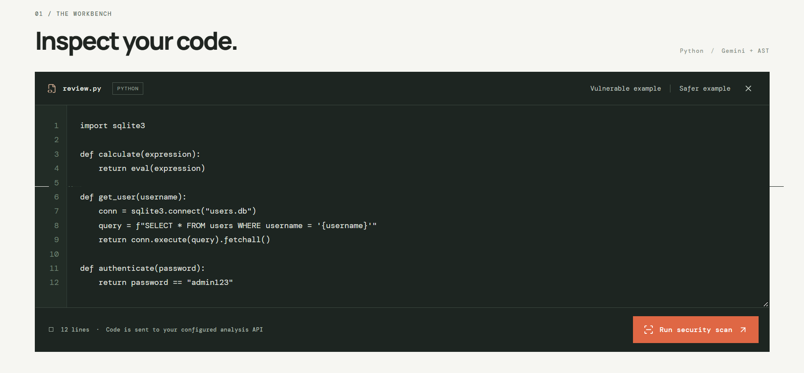
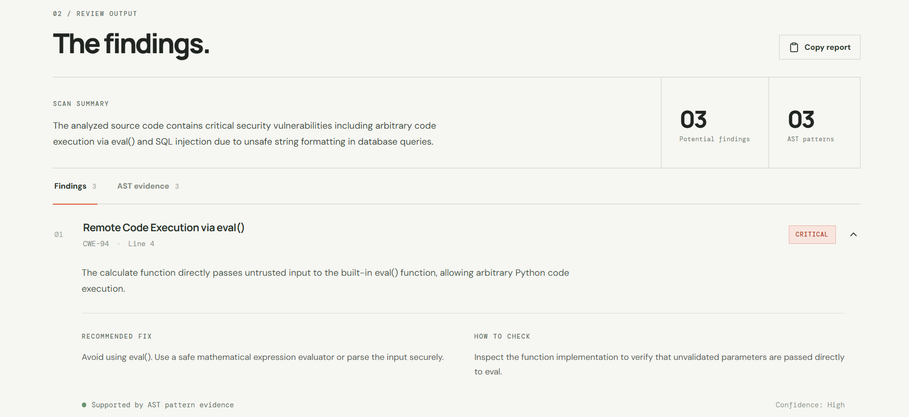
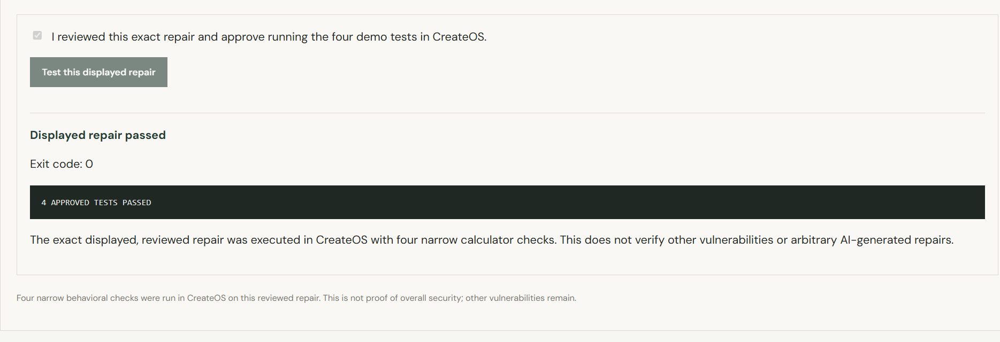

# AgentGuard

**Find the flaw. Understand the fix.**

AgentGuard is a local-first Python security review workbench built for the CreateOS × Stripe Projects hackathon. It combines Gemini's explanations with independent Python AST pattern checks, then lets a reviewer inspect and explicitly approve a **developer-reviewed demo repair** for controlled behavioral testing in a CreateOS Sandbox.

> **Demo scope:** The CreateOS execution path accepts only the bundled, reviewed calculator repair. AgentGuard does **not** execute arbitrary submitted Python or Gemini-generated patches.

## What it does

1. **Analyze Python source:** Gemini identifies potential weaknesses and explains their risk and possible fixes.
2. **Check independent evidence:** A Python AST verifier identifies supported patterns, including direct `eval()` calls (CWE-94), selected SQL-query construction patterns (CWE-89), and hardcoded-password patterns (CWE-798).
3. **Propose repairs:** Gemini generates a suggested patch; the workbench displays the original and proposed source with static-check results. A cleared AST pattern is not proof of a safe or behavior-preserving repair.
4. **Review and approve:** For the bundled vulnerable calculator example, a separate developer-reviewed arithmetic parser can be loaded and inspected. Testing requires explicit approval.
5. **Test the displayed reviewed repair:** The backend checks a short-lived, one-use patch token and executes the exact approved demo template with four calculator behavior checks in a fresh CreateOS Sandbox. The interface reports the actual result and exit code.

## Demo result

In the local demo, the reviewed calculator repair returned **4/4 approved behavioral tests passed**, with **exit code 0** from CreateOS. This result applies **only to that reviewed template and those four tests**; it does not validate the Gemini patch, the full program, or the remaining vulnerabilities.

## Architecture

```text
React + Vite workbench (localhost:5173)
             |
             v
Express API (localhost:3001)
    |             |                 |
    v             v                 v
Gemini API    Python AST        CreateOS Sandbox
analysis &    verifier          approved demo repair
suggestions   (no execution)    + four behavior tests
```

**Stack:** React, Vite, Node.js, Express, Gemini (`@google/genai`), Python standard-library `ast`, CreateOS Sandbox SDK (`@nodeops-createos/sandbox`).

## Run locally

### Prerequisites

- Node.js and npm compatible with your installed Vite version
- Python 3 accessible as `python` in your terminal (the backend launches `python verifier.py`)
- Gemini API key
- CreateOS Sandbox credentials and account access for sandbox tests

### Install

From the repository root:

```powershell
npm install
cd frontend
npm install
cd ..
```

Create a local `.env` file in the repository root:

```dotenv
GEMINI_API_KEY=your_gemini_api_key
GEMINI_MODEL=your_available_gemini_model
CREATEOS_SANDBOX_API_KEY=your_createos_sandbox_key
```

Use the Gemini model identifier enabled for your account. **Never commit `.env` or API credentials.** The CreateOS SDK must be configured with credentials appropriate to your account.

### Start

In terminal 1, from the repository root:

```powershell
node --check server.js
node server.js
```

In terminal 2:

```powershell
cd frontend
npm run dev
```

Open **http://localhost:5173**. The API health endpoint is **http://localhost:3001/api/health**.

### Demo walkthrough

1. Click **Vulnerable example** and **Run security scan**.
2. Expand the `eval()` / CWE-94 finding and inspect Gemini's explanation alongside AST evidence.
3. Click **Generate suggested fix** to see an AI-proposed patch and its limitations.
4. Click **Load reviewed calculator repair** to switch to the distinct developer-reviewed arithmetic parser.
5. Review the displayed code, check the approval box, and click **Test this displayed repair**.
6. Inspect the CreateOS output. The expected successful demo displays **4 APPROVED TESTS PASSED** and exit code **0**.

## Verification boundaries and limitations

- Findings are **potential vulnerabilities**, not proof of exploitability. The AST verifier covers a small number of recognizable patterns; it is not a comprehensive security scanner.
- Gemini output can be incomplete, incorrect, or change between runs. In particular, a suggested patch may remove a dangerous function **by disabling legitimate behavior**.
- AI and AST findings may occasionally overlap or have different line numbers.
- The approved demo repair addresses the calculator's `eval()` issue; the bundled example's SQL injection and hardcoded password issues remain.
- The four CreateOS tests check narrow calculator behavior only. Passing them does not prove security, complete compatibility, or freedom from resource-exhaustion bugs.
- Sandbox use is intentionally restricted to the exact reviewed template, with explicit approval and a short-lived one-time token. This prototype has **not** established a production-grade isolation, networking, or resource-control policy for arbitrary untrusted code. Do not expose it as a public code execution service.
- This is a local hackathon prototype, not a production security assessment tool.

## Project layout

```text
agentguard/
├── server.js                # API, Gemini integration, approved CreateOS demo
├── verifier.py              # Static Python AST pattern checks
├── test_verifier.py         # Verifier tests, if present in your local project
├── frontend/
│   └── src/
│       ├── App.jsx          # Workbench interface
│       └── App.css          # Interface styles
└── .env                     # Local secrets; do not commit
```

## Responsible use

Only scan code you own or are authorized to review. Review all findings and proposed fixes manually before relying on them. Keep credentials out of the repository and out of screenshots.

## Hackathon

Built for the **CreateOS × Stripe Projects** hackathon (October 17, 2026). Submission and Stripe Projects leaderboard access depend on organizer requirements; the local prototype's success does not imply an official submission has been completed.


## Screenshots

### Security Workbench


### Vulnerability Detection


### CreateOS Sandbox Testing
